Overview
=====
DeepResearchAgent is a multi-user web application that answers research questions
from uploaded documents and the public web and writes cited reports. A Deep Agents
worker plans the work, retrieves from private documents (pgvector hybrid search),
searches and reads web pages, delegates sub-questions to subagents, and checkpoints
every step to PostgreSQL so runs survive restarts, duplicate deliveries and
cancellation.

The project covers the full agent development lifecycle:

- **Build**:
  - Deep Agents harness with custom tools;
  - guard middleware for approval, cancellation, lease and time limits;
  - fenced LangGraph checkpoints;
  - explicit, user-managed long-term memory.
- **Test**: about a hundred offline tests. The agent tests drive the real harness with a deterministic fake model.
- **Deploy**:
  - Terraform and Helm on EKS, Bedrock and Cognito;
  - GitHub Actions with OIDC;
  - staging before production, and disposable environments.
- **Observe**: self-hosted Langfuse with full traces and per-question cost.
- **Evaluate**:
  - a 20-case synthetic dataset;
  - experiments run inside the deployed worker;
  - four LLM-as-a-judge evaluators (DeepSeek V3.2 on Bedrock).
- **Improve**: prompt fixes raised passing cases from 15 to 18 of 20 and overall quality from 0.62 to 0.85, and cut agent cost from $0.67 to $0.37 per 20 questions.

Architecture
=====

Read more
=====
- Blog post: [Building a Deep Research Agent End to End](/posts/2026/11/deep-research-agent-adlc/)
- GitHub: [sagar-spkt/DeepResearchAgent](https://github.com/sagar-spkt/DeepResearchAgent)
