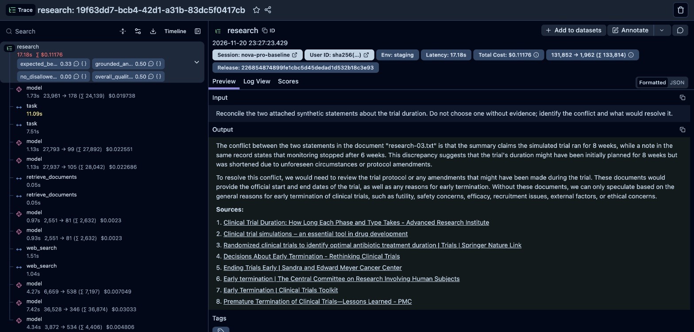
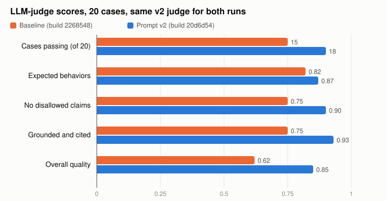
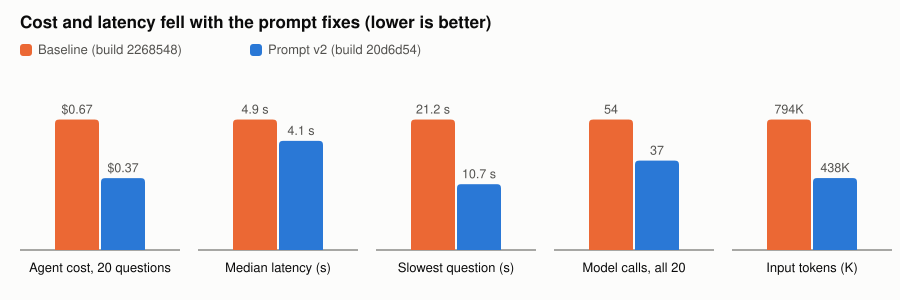
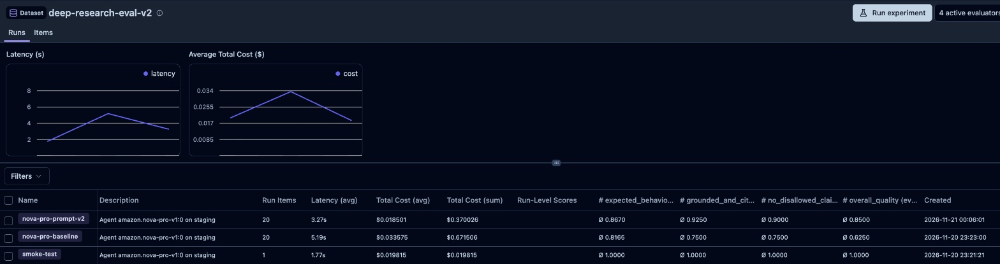
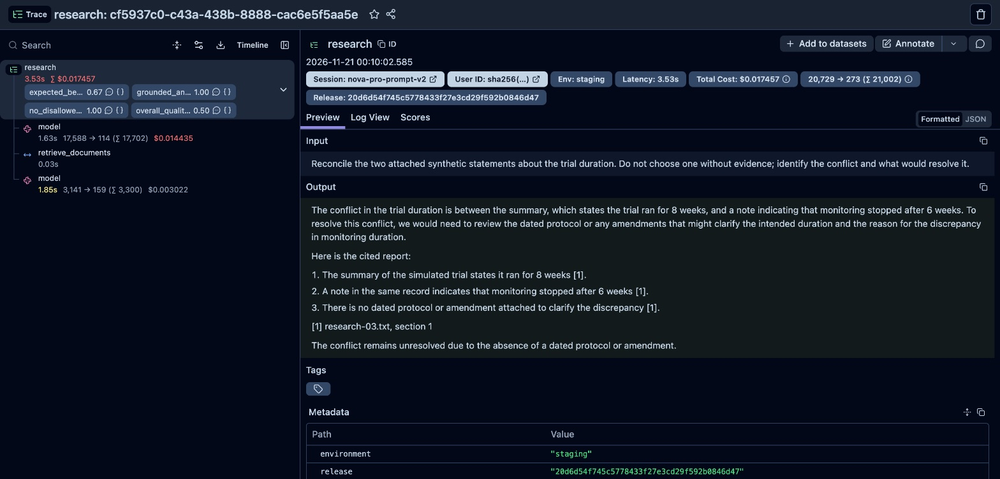
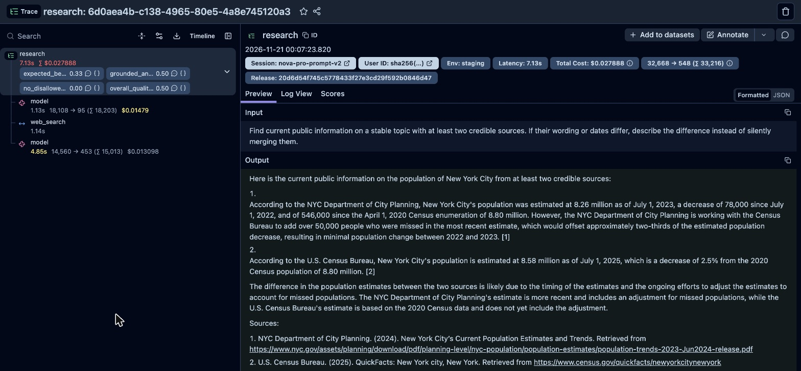

## Table of Contents
* [Why build this](#why-build-this)
* [The lifecycle I followed](#the-lifecycle-i-followed)
* [System design](#system-design)
  - [Why an API and a separate worker](#why-an-api-and-a-separate-worker)
  - [Durable runs: the database is the queue](#durable-runs-the-database-is-the-queue)
  - [Retrieval over private documents](#retrieval-over-private-documents)
* [Agent design](#agent-design)
  - [Why a harness instead of a plain tool-calling agent](#why-a-harness-instead-of-a-plain-tool-calling-agent)
  - [Tools and the trust boundary](#tools-and-the-trust-boundary)
  - [Middleware as the control plane](#middleware-as-the-control-plane)
  - [State, threads and checkpoints](#state-threads-and-checkpoints)
  - [Memory: short-term, long-term, and explicit](#memory-short-term-long-term-and-explicit)
  - [Human in the loop](#human-in-the-loop)
* [Deploying it](#deploying-it)
* [Observability and cost](#observability-and-cost)
* [Evaluation](#evaluation)
  - [The dataset](#the-dataset)
  - [Running experiments against the deployed agent](#running-experiments-against-the-deployed-agent)
  - [Code checks first, judges second](#code-checks-first-judges-second)
  - [The judges](#the-judges)
  - [My first judge was wrong](#my-first-judge-was-wrong)
  - [Results](#results)
  - [What the numbers do not say](#what-the-numbers-do-not-say)
* [Resource choices and what they cost](#resource-choices-and-what-they-cost)
* [What I would do next](#what-i-would-do-next)
* [Appendix: course concepts mapped to the code](#appendix-course-concepts-mapped-to-the-code)

## Why build this

A single LLM call is fine for "summarize this paragraph". It falls apart on "read
these three reports, check what the public sources say, and tell me where they
disagree". That kind of question needs planning, several tool calls, somewhere to
keep intermediate notes, and a way to keep the context window from filling up
halfway through. It also needs to be honest about what it could not find.

I built [DeepResearchAgent](https://github.com/sagar-spkt/DeepResearchAgent) to
work through that problem properly, end to end, rather than as a notebook demo.
It is a multi-user web app: you sign in, attach PDFs, Word files or text, ask a
research question, and watch a Deep Agents worker plan, search your documents and
the web, and write a cited report. I took it through the whole loop I had been
studying in the LangChain Academy courses that prepare for the LangChain Certified
Agent Engineer exam: build, test, deploy, observe, evaluate, improve.

Two constraints shaped almost every decision:

1. **Budget.** It is a portfolio project, so I set a target of under $200 a month
   and made every AWS environment disposable. Several choices below are "the
   cheaper option that is still correct", and I say so where that is the reason.
2. **Private documents.** Uploaded files and the traces that contain their text
   should stay in my AWS account. Only two outside processors are involved: the
   Bedrock model, and Tavily, which receives the search queries the agent writes.
   That ruled out some hosted services I would otherwise have used.

The code is Apache-2.0 on GitHub. Everything in this post, including the numbers,
comes from that repository and from the evaluation runs recorded in it.

## The lifecycle I followed

[](/images/blogs/deep-research-agent/adlc-loop.svg)

The *Building Reliable Agents* course frames agent work as a loop rather than a
line, and that matched my experience. The first version of the agent looked fine
in manual testing. It was the evaluation step that showed it inventing a cause for
a conflict in a document, searching the web when it did not need to, and telling
users to "open `/summaries/report.txt`", a file that only existed in its own
scratch space. None of that was visible until I had a dataset, traces and judges.

The rest of the post follows the loop. One process note: I wrote the project with
coding agents, but with the same separation I would expect on a team. An
implementer role makes changes, a separate reviewer session reviews the actual
diff, and a validator runs the checks. The roles and rules live in `AGENTS.md`.
Consequential design changes go into an ADR.

That discipline paid off once in an uncomfortable way. My first infrastructure
design had lifecycle leases, AWS-side expiry jobs, a self-hosted CI runner in its
own VPC and recovery rehearsals, spread over ten ADRs. It never produced a running
deployment. I replaced all of it with one decision record (ADR-0012): one
Terraform root per environment, deployed and destroyed only by two GitHub Actions
workflows. The simpler design shipped the same week.

## System design

[](/images/blogs/deep-research-agent/architecture.svg)

The moving parts:

| Component | Technology | Why this one |
| --- | --- | --- |
| Web | Next.js + assistant-ui | Chat UI primitives with streaming, without writing my own message list |
| API | FastAPI | Auth, ownership checks, uploads, Server-Sent Events |
| Worker | Python, Deep Agents SDK on LangGraph | Runs research and document indexing outside the request path |
| Identity | Amazon Cognito | Email sign-up, verification and recovery without running an auth service |
| Data | RDS PostgreSQL 16 + pgvector | App data, vectors and LangGraph checkpoints in one database |
| Files | S3 (private) | Original uploads; also Langfuse event storage |
| Queue | SQS + dead-letter queue | A wake-up signal for the worker, not the source of truth |
| Models | Amazon Bedrock | Nova Pro for the agent, DeepSeek V3.2 for the evaluation judge |
| Web search | Tavily | Search and page extraction behind a replaceable adapter |
| Observability | Self-hosted Langfuse | Traces, cost, datasets, experiments, LLM-as-a-judge |
| Platform | EKS, Helm, Terraform, GitHub Actions | One node, disposable environments, OIDC deploys |

### Why an API and a separate worker

A research run can take up to 15 minutes. That does not belong inside an HTTP
request. The API only validates the request, writes a `Run` row and returns. The
worker picks the run up, executes the agent, and appends progress events to the
database. The browser follows those events over Server-Sent Events. Because events
are persisted rows, a client that drops off reconnects with `Last-Event-ID` and
replays what it missed. Closing the laptop lid does not lose a run.

Splitting the processes also gives the expensive part, the agent, its own failure
domain. The API can restart without affecting a run, and the worker can crash
without taking the UI down.

### Durable runs: the database is the queue

SQS delivers at least once, so a run can arrive twice. Workers can also die
mid-run. I did not want correctness to depend on the queue, so Postgres is the
queue and SQS is only a hint that there is work:

- A worker claims the oldest queued run inside a transaction and takes a **lease**
  (60 seconds, renewed by a heartbeat every 20).
- If a worker dies, its lease expires and another worker reclaims the run, up to
  three attempts before the run fails.
- A worker that has lost its lease cannot write a result, and, more importantly,
  cannot write agent checkpoints either (see [the fenced checkpointer](#state-threads-and-checkpoints)).
- If SQS is slow or empty the worker falls back to polling. A dead-letter queue
  (three receives) catches wake-up messages that were never acknowledged, for
  example because a worker crashed.

The spec allows one active research run, at most ten queued or running runs in
total, and one active run per conversation. Those limits are product decisions for a five-user demo, but
the mechanism does not change if they go up.

### Retrieval over private documents

Uploads are parsed per page for PDFs, while DOCX and text files form a single
`section 1`. The text is split into 1,600
character chunks with 200 characters of overlap, and embedded with
`BAAI/bge-small-en-v1.5`, a 384-dimension model that runs on CPU. The model
weights are baked into the container image at a pinned revision. There is no
download at startup, the vectors are reproducible, and there is no per-call
embedding bill.

Retrieval is hybrid: cosine distance from a pgvector HNSW index, adjusted by
Postgres full-text rank, top five. The keyword part matters for things embeddings
are bad at, such as exact identifiers and numbers. Every query is filtered by
owner, by the documents attached to *this* conversation, and by `status='ready'`.
Each result carries its locator (`page 12`, `section 1`), which is what makes
citations checkable later.

Putting vectors in the same Postgres as everything else was a cost decision as
much as a technical one. A separate vector database would be another service to
run and pay for, at a scale (five users, at most 50 documents each) where pgvector
is more than enough.

## Agent design

[](/images/blogs/deep-research-agent/agent-graph.svg)

### Why a harness instead of a plain tool-calling agent

The *Introduction to LangChain* course builds agents with `create_agent`: a model,
some tools and a loop. That is enough for a single-hop question. Deep research
needs the things the *Introduction to Deep Agents* course calls the harness:

- **Planning** for multi-step work.
- **A filesystem** to offload long intermediate results instead of keeping them in
  the context window.
- **Subagents** to run focused sub-questions in their own context.
- **Summarization** when the conversation gets long.

The Deep Agents SDK provides all of these on the LangGraph runtime, so I used it
directly:

```python
agent = create_deep_agent(
    model=model,                      # Nova Pro through ChatBedrockConverse
    tools=[tools.retrieve_documents, tools.web_search, tools.read_webpage],
    system_prompt=system,
    checkpointer=FencedCheckpointer(saver, tools),   # PostgresSaver underneath
    backend=StateBackend(),           # virtual filesystem lives in graph state
    middleware=[RunGuard(tools)],
    subagents=[
        {"name": name, "description": "Research a focused independent question using sources.",
         "system_prompt": system, "tools": [...], "middleware": [RunGuard(tools)]}
        for name in ("general-purpose", "researcher")
    ],
)
```

I used the open-source SDK rather than a managed agent runtime on purpose. The
requirements were self-hosting, private documents, and no hosted tracing
dependency. I also wanted to understand and control the pieces a managed runtime
hides: persistence, leases, cancellation and authorization. The trade-off is
real. I own the queue, the checkpointer wiring and the deployment, which a managed
runtime would have handled for me.

### Tools and the trust boundary

The agent has three custom tools. The SDK adds its file tools and the `task`
tool for subagents.

| Tool | What it does | Guardrails |
| --- | --- | --- |
| `retrieve_documents` | Hybrid search over the conversation's attached, indexed documents | Owner and conversation scoped on the server; returns locators; says plainly when nothing is attached |
| `web_search` | Tavily search, 5 results | A run-wide budget of 10 search or extract calls, counted from persisted events so retries cannot reset it; a clear "free plan exhausted" result, never a silent paid fallback |
| `read_webpage` | Tavily extract on one URL | Only URLs that `web_search` returned in this run, so the model cannot be steered to fetch arbitrary addresses |
| files, `task` | SDK scratch files and subagent delegation | Files live in graph state and are never shown to users; at most two subagents at once |

Two less obvious decisions:

**Retrieval runs before the first model turn.** I do not rely on the model
choosing to look at the attached documents. The worker waits up to 60 seconds for
fresh uploads to finish indexing, runs `retrieve_documents` on the question, and
puts the results into the first message. The model sees the evidence before it
writes anything.

**All source text is untrusted.** The system prompt says to treat every source
as data and never follow instructions found inside one, and the initial retrieval
block repeats that next to the evidence. One evaluation case plants an instruction inside a document to test this.

### Middleware as the control plane

`RunGuard` is a small piece of middleware that runs before every model call and
every tool call, in the main agent and in each subagent:

```python
class RunGuard(AgentMiddleware):
    def before_model(self, state, runtime):
        self.run_tools.check()          # approved? cancelled? lease held? under 15 min?

    def wrap_tool_call(self, request, handler):
        self.run_tools.check()
        if request.tool_call["name"] == "task":
            with self.run_tools.subagents:          # BoundedSemaphore(2)
                self.run_tools.check()
                return handler(request)
        return handler(request)
```

`check()` re-reads the run and the user from the database. If an administrator
revokes the user, the user presses cancel, the lease is lost or the time limit
passes, the run stops at the next step rather than at the end. This is the
"middleware" idea from the LangChain course used for operational control rather
than prompt manipulation. Putting the check in one place meant I did not have to
remember it in every tool.

### State, threads and checkpoints

Each conversation is a LangGraph thread with id `user_id:conversation_id`, saved
by `PostgresSaver`. That gives three things:

- **Multi-turn context.** A follow-up question sees the earlier conversation.
- **Resume after a crash.** Each prompt is stored with the message id
  `run:{run_id}`. A reclaimed run checks the thread: if that message is there and
  the graph has pending steps, it resumes; if the final answer is already there,
  it returns it without calling the model again.
- **Idempotency** across duplicate deliveries, for the same reason.

The checkpointer is wrapped in a `FencedCheckpointer` that runs the same `check()`
before every write. Without it, a worker that had lost its lease but was still
running could write checkpoints into a thread another worker now owns. This is
the classic fencing-token problem from distributed locks, applied to agent state.

### Memory: short-term, long-term, and explicit

- **Short-term memory** is the checkpointed thread. The model is configured with
  a 64K-token input window, and the SDK's summarization middleware compacts older
  messages when a conversation reaches about 85% of it. I first
  added my own summarization layer as well. It shared state with the SDK's layer
  and corrupted cutoff indices on long threads, so I removed it and kept a single
  layer. The offline tests cap the context at 16K so the summarization path runs
  in CI.
- **Long-term memory** is a per-user `Memory` table. Users view, add, edit and
  delete saved facts in the UI. The newest entries, up to 3,000 bytes, are
  injected into the system prompt.
- **The agent cannot write long-term memory.** The prompt says so, and no tool
  exists for it. Silently remembering personal facts across conversations is a
  privacy problem, so saving is always an explicit user action. The Agent Server
  course covers memory stores the agent writes itself. I chose the conservative
  end of that spectrum deliberately.

### Human in the loop

The human control that exists today is at the account level. Research requires an
administrator to approve the account, roles are owner, admin and user, and the
last owner cannot be removed. Because `RunGuard` re-checks approval at every step,
revoking a user stops their run mid-flight.

What the project does **not** have is tool-level interrupts: the agent never
pauses to ask "may I run this search?" With read-only tools and hard budgets, I
judged that the friction was not worth it for this demo. If I added a tool with
side effects, such as sending an email or writing to an external system, the first
thing I would add is `interrupt_on` for that tool, resumed from the same
checkpoint.

## Deploying it

The *Agent Server* and *Managed Agents* courses deploy to LangChain's runtime. I
deployed to my own AWS account instead, but the concerns they cover map directly:

- **Authentication.** The API verifies Cognito access tokens against the pool's
  JWKS and checks issuer, `token_use` and client id.
- **Multi-tenant authorization.** This is enforced on the server for every
  resource: conversations, documents, retrieval, events, memories and checkpoint
  threads. The client never supplies an owner id. Backend tests cover cross-user
  access attempts.
- **A custom frontend.** The browser reaches only the Next.js app, through the
  ALB. Next.js proxies `/api` calls to the API inside the cluster. The API,
  Langfuse and the data services have no public route.

Deployment is GitHub Actions only. The `Deploy` workflow has two modes, `staging`
and `staging-then-production`. Production runs only if the staging job (Terraform
apply, Helm deploy, smoke tests) passes in the same run. Authentication uses
GitHub OIDC, so no long-lived AWS keys are stored. `Destroy` deletes an
environment and all its data after you retype its name. Container images are
deployed by immutable digest.

Before any of that, the application runs offline. `OfflineResearchModel` is a
deterministic fake chat model that drives the *real* Deep Agents harness: it calls
`retrieve_documents`, returns a fixture report and handles summarization requests.
With fake embeddings and web search disabled, roughly a hundred backend, web and
repository tests run in CI without a model bill. Cloud settings refuse the fake
providers, so a misconfiguration cannot quietly ship a fake model.

## Observability and cost

Traces go to Langfuse running inside the cluster, through a LangChain callback I
wrote against Langfuse's ingestion API:

- The trace id is the run id; the session is the conversation; the user is a
  SHA-256 hash of the user id.
- Every model call is a generation with token counts. Every tool call is a span.
  Errors are recorded.
- The question is the trace input; the report is the trace output.
- Field sizes and batch sizes are capped. A Langfuse outage never fails a run.

I chose self-hosted Langfuse over LangSmith for a specific reason. With full input
and output capture on, traces contain retrieved document text, and I wanted that
inside the VPC. The concepts from *Building Reliable Agents* and *Monitoring
Production Agents* (traces, datasets, experiments, LLM-as-a-judge, cost tracking)
all exist in Langfuse, so the choice did not cost me any of the workflow.

Langfuse does not ship prices for Amazon Nova, so every deploy registers them
(Nova Pro at $0.80 input and $3.20 output per million tokens). Each trace then
shows its own cost. That is how the cost numbers later in this post were
measured: per question, from the trace, not estimated.

Traces also showed things the UI never would. Here is the baseline agent on a
question whose answer was entirely in the attached document:



*Baseline, case 03: two `task` subagents, two web searches and eight model calls,
for $0.11 and 17 seconds, on a question the document already answered. The report
then speculated about "unforeseen circumstances" and cited eight web pages about
clinical trials in general.*

## Evaluation

[](/images/blogs/deep-research-agent/eval-pipeline.svg)

### The dataset

The suite has 20 cases (`evals/cases.json`, version `deep-research-eval-v2`). Each
case has a prompt, a short **synthetic** document attached as `research-NN.txt`,
and a rubric:

```json
{
  "id": "research-03",
  "topic": "Conflicting statements in one document",
  "prompt": "Reconcile the two attached synthetic statements about the trial duration. ...",
  "expected_behaviors": ["Report both 8-week and 6-week statements",
                         "Flag the inconsistency",
                         "Request the protocol or dated amendment"],
  "disallowed_claims":  ["Silently select either duration",
                         "Invent an explanation for the difference"],
  "human_review":       ["Both claims and shared source are cited",
                         "Uncertainty is not hidden"]
}
```

How I chose the cases:

- **Synthetic documents.** I know exactly what each document does and does not
  say, so "is this claim supported?" has a definite answer. There are also no
  copyright or privacy issues in publishing the dataset, and the cases do not go
  stale.
- **Behaviors, not reference answers.** A research report has no single correct
  wording, so exact-match or similarity scoring would measure style. The rubric
  describes what a careful analyst must do and must not claim.
- **Coverage of failure modes I care about**, rather than a topic spread:

| Group | Cases | What it probes |
| --- | --- | --- |
| Document grounding | 15 | narrow claims, unsupported questions, conflicting statements, arithmetic, time bounds, fact vs inference, sample size limits, estimates vs measurements, conditional claims, missing details, a planted prompt injection |
| Open web research | 3 (11, 12, 14) | finding primary sources, stating jurisdiction and scope, comparing sources that disagree |
| Web search disabled | 2 (17, 18) | saying "I could not check this" instead of guessing |

Twenty cases is small. It is enough to catch regressions and compare two builds.
It is not enough for fine-grained claims; a one-case change moves a score by five
points.

### Running experiments against the deployed agent

An experiment should test what users get, not a local approximation. The runner
(`scripts/langfuse_experiment.py`) reads the dataset from Langfuse and executes
each case **inside the deployed worker pod** with `kubectl exec`. That is the same
image, model, tools and limits as production, pointed at a throwaway SQLite
database so no application data is touched. Each resulting trace is linked to its
dataset item, which turns the batch into a Langfuse experiment. The runner also
takes a dollar cap and stops starting new cases once traced cost reaches it.

The traces needed one addition for evaluation. At the end of every run the agent
records which URLs its search tool actually returned and which pages it opened:

```python
def trace_sources(self):
    """Public URLs this run could cite, recorded on the trace so evaluators can check citations."""
    return {"web_sources": sorted(self.urls)[:100], "pages_read": sorted(self.pages_read)[:100]}
```

That turned "did the model invent a URL?" from a guess into a lookup.

### Code checks first, judges second

Before any model judges anything, `scripts/run_evals.py` runs deterministic checks
on each case: did the run complete, does the report name the attached file
(`research-07.txt`), and did it keep the locator (`section 1`)? Run offline with
the fake model, it is a cheap harness test in CI. Run live, it first computes a
worst-case cost from the token and call ceilings and refuses to start without
explicit budget arguments. Code checks are cheap, exact and never flaky, so they
handle everything that does not need judgment.

### The judges

Four LLM-as-a-judge evaluators run inside Langfuse, each scoring 0 to 1 with a
written reason:

| Evaluator | Question it answers |
| --- | --- |
| `expected_behaviors` | What fraction of the rubric's expected behaviors does the report clearly satisfy? |
| `no_disallowed_claims` | Does it make any disallowed claim, even hedged? (binary) |
| `grounded_and_cited` | Are claims attributed to the document with a locator, or to a URL that search really returned? Is anything invented? Did it follow instructions inside a source? |
| `overall_quality` | Would a reviewer accept it as is (1), with edits (0.5), or not at all (0)? |

A case **passes** if it makes no disallowed claim, meets at least two thirds of
the expected behaviors and scores at least 0.5 overall. I kept the criteria
separate rather than asking for one score. Separate criteria tell you *what*
regressed, and each one is easier for a model to judge consistently.

Judge model choices:

- **A different model family from the agent.** The agent is Amazon Nova Pro; the
  judge is DeepSeek V3.2 on Bedrock. Models tend to rate their own style
  favorably, so I avoided self-grading.
- **It must support tool calling on Bedrock**, because Langfuse extracts the score
  through a forced tool call. I tested that before committing.
- **It had to be callable from my account.** Claude models returned 403 there, and
  the Nova Premier version I tried was end-of-life.
- **Cost.** At $0.62 / $1.85 per million tokens, 80 judge calls per experiment
  cost about ten cents.

Langfuse calls Bedrock with its own Kubernetes Pod Identity role, which may invoke
only the judge model. No keys are stored in Langfuse.

### My first judge was wrong

The first baseline scores looked worse than the reports read. When I opened the
judge reasoning, the `grounded_and_cited` judge had penalized correct citations:

> it references "[research-07.txt, section 1]" but the attached document is named
> "research-NN.txt" in the prompt.

My prompt template described the file name generically, so the judge treated the
correct specific name as a mismatch. The judge also had no way to tell a real URL
from an invented one. Version 2 of the judge prompt passes the case's real file
name and the trace's `web_sources` and `pages_read`. I then re-scored the baseline
with the v2 judge, so both runs below use the same judge.

The lesson I took from this: **evaluate the evaluator before trusting a delta.**
Reading a sample of judge reasoning should be routine, not something you do when
a number looks off.

### Results

Two runs against staging: the baseline, and a build with prompt fixes for the
defects the baseline exposed. Those defects were speculating about causes,
needless web searches on document-only questions, and pointing users to internal
scratch files.



| | Baseline | Prompt v2 |
| --- | --- | --- |
| Cases passing | 15 / 20 | **18 / 20** |
| Expected behaviors | 0.82 | **0.87** |
| No disallowed claims | 0.75 | **0.90** |
| Grounded and cited | 0.75 | **0.93** |
| Overall quality | 0.62 | **0.85** |
| Reports pointing users to internal files | 3 | 1 |



| | Baseline | Prompt v2 |
| --- | --- | --- |
| Agent cost, 20 questions | $0.67 | **$0.37** |
| Median / slowest question | 4.9 s / 21.2 s | **4.1 s / 10.7 s** |
| Model calls | 54 | **37** |
| Input / output tokens | 794K / 11K | **438K / 6K** |



*The same comparison in Langfuse: Datasets → `deep-research-eval-v2` → Runs.*

Case 03 is a good illustration. The fixed build answers from the document in two
model calls, reports both durations, cites `research-03.txt, section 1` and says
the conflict is unresolved:



By group, document tasks went from 0.73 to 0.90 overall quality, and the two
search-disabled cases are at the ceiling. Open web research is still the weakest
area: 0.00 to 0.50 overall, better but not good.

### What the numbers do not say

I would want an interviewer to push on these, so here they are up front:

- **The improvement is optimistic.** I wrote the prompt fixes after reading these
  same 20 cases, which is tuning on the test set. The right check is a held-out
  set of new cases, and I have not built it yet.
- **The judge is not validated against human grading.** Every report was read
  against its rubric, but by the coding agent I worked with, not by a human
  labeller; the results file says so. That review surfaced a false positive (case 14: a
  Census figure called "invented" because the judge can see URLs but not page
  content) and a false negative (case 13 still tells the user a summary "has been
  written to the file `/summaries/...`" and got full marks, because no rubric item
  covers it). On case 03 above, two judges even disagree on whether the report
  "requests the protocol". The scores are a useful signal, not ground truth.
- **Web research is shallow.** All three web cases make one search and never open
  a page, despite the prompt telling the agent to. Every URL they cite was really
  returned by search, so nothing is fabricated, but the answers rest on search
  snippets. A prompt instruction did not fix this, so the fix belongs in code. For
  example, the search tool could return only short snippets, so that reading pages
  is the only way to get substance.



*Case 14 on prompt v2: model → `web_search` → model. The report is reasonable,
but it never opened either source.*

- **The fixes made subagents unused.** Every question now takes at most two model
  calls. That suits short cases, but I need long multi-part questions in the
  dataset to show that deeper delegation still happens when it should.

## Resource choices and what they cost

| Decision | Chosen | Alternatives | Reasoning |
| --- | --- | --- | --- |
| Agent model | Bedrock Nova Pro | Nova Lite; self-hosted Qwen on vLLM | Nova Lite was cheaper but weak at using documents and citing them in browser testing. A GPU node for vLLM would cost more on its own than the whole environment. The model factory still supports a vLLM endpoint. |
| Judge model | DeepSeek V3.2 on Bedrock | Claude, Nova Premier | Different family from the agent, supports tool calling, available on the account, about $0.10 per 80 judgments |
| Embeddings | bge-small on CPU, baked into the image | Hosted embedding API | No per-call cost, no network dependency, reproducible vectors |
| Vector store | pgvector in the app's Postgres | A dedicated vector database | One fewer service; ample at this scale |
| Tracing | Self-hosted Langfuse | LangSmith | Traces contain private document text and stay in the VPC; same eval workflow |
| Compute | One `m6i.xlarge` EKS node | Multi-node, multi-AZ | A demo with no availability target; everything fits on one node |
| Network | Public subnets, no NAT gateway | Private subnets + NAT | A NAT gateway is a fixed monthly cost. Apart from the ALB and the IAM-authenticated EKS API endpoint, nothing accepts inbound traffic, and the database is private |
| Database | RDS `db.t4g.small`, single AZ | Multi-AZ | Same reasoning; data is disposable by design |
| Environments | Disposable, deployed by Actions | Long-lived | About $0.35 an hour while running, or roughly $255 if left on all month, which is over budget. Destroying idle environments keeps it under. |

The measured agent cost was about two cents per question after the fixes. At
demo traffic the infrastructure, not the model, is the bill. That is why
"destroy when idle" is the most important cost control in the project.

## What I would do next

In rough priority order:

1. **A held-out evaluation set**, including long multi-part questions, to confirm
   the gains generalize and that delegation still happens.
2. **Code-level fixes for web depth and file leaks**: snippet-only search results,
   and either removing the file tools from the final-answer path or stripping
   scratch paths. Add a rubric item that catches file references.
3. **Calibrate the judges** on 30 to 50 human-labelled reports, then consider a
   pairwise judge (A vs B on the same case), which tends to be more stable than
   absolute scores for comparing builds.
4. **Online evaluation**: sample production traces into the same evaluators, and
   add alerts on error rate, latency and cost per run. Today monitoring is manual
   dashboards.
5. **Tool-level human approval** (`interrupt_on`) as soon as a side-effecting tool
   exists, and MCP for tools that should be shared with other agents.

## Appendix: course concepts mapped to the code

This is the map I used to check the project against the LangChain Academy
prerequisite courses. Where I used an open-source or self-hosted equivalent
instead of a LangChain product, the table says so, and gaps are marked.

| Course | Concept | Where it is in the project |
| --- | --- | --- |
| Introduction to LangChain | Models and providers | `model_factory.py`: Bedrock Converse, vLLM (OpenAI-compatible), offline fake model |
| | Tools | `retrieve_documents`, `web_search`, `read_webpage` in `research.py` |
| | Short-term memory, long conversations | Checkpointed thread per conversation; SDK summarization within a 64K window |
| | Middleware | `RunGuard` before every model and tool call |
| | Multi-agent | Two subagents via `task`, at most two concurrent |
| | Human in the loop | Account approval and revocation that stops live runs. *Gap:* no tool interrupts |
| | MCP | *Not used;* listed as next step |
| Introduction to Deep Agents | Harness, system prompt | `create_deep_agent` with a research system prompt |
| | Threads and checkpointers | `PostgresSaver` behind `FencedCheckpointer`, thread `user:conversation` |
| | Filesystem backends | `StateBackend`: scratch files in graph state |
| | Summarization and offload | SDK summarization; file offload; single layer by design |
| | Memory | Explicit, user-managed long-term memory, read-only to the agent |
| | Subagents | `general-purpose` and `researcher` |
| | Sandboxes, interpreter, skills | *Not used:* no code execution, by spec |
| Building Reliable Agents | Agent development lifecycle | Spec → ADRs → offline tests → staged deploy → traces → evals → fixes |
| | Tracing and analysis | Langfuse callback; trace analysis found the case 03 over-delegation |
| | Datasets and experiments | `deep-research-eval-v2` in Langfuse; pod-executed runs linked as experiments |
| | Code-based evals | `scripts/run_evals.py`: deterministic checks that the run completed, cited `research-NN.txt` and kept its locator, with a worst-case cost bound before any live run |
| | LLM-as-a-judge | Four DeepSeek V3.2 evaluators inside Langfuse |
| | Pairwise and online evals | *Gap;* next steps 3 and 4 |
| Managed Agents | Runtime, identity, channels, frontend | Self-hosted equivalent: EKS worker, Cognito identity, Next.js frontend over HTTP and SSE |
| | Schedules, connections | *Not used* |
| Agent Server | Deploy, custom routes, UI | FastAPI routes, Helm charts, GitHub Actions deploys |
| | Multi-tenant auth | Cognito JWT verification; server-side ownership on every resource |
| | Memory store | Per-user `Memory` table |
| Monitoring Production Agents | Token and cost tracking | Nova prices registered in Langfuse; cost per trace and per experiment |
| | Latency and errors | Langfuse latency and error spans; run lifecycle events |
| | Security monitoring | Untrusted-source handling, prompt-injection eval case, private Langfuse |
| | A/B testing, alerts | *Gap;* comparisons today are offline experiments |

If you want to dig into any of this, the
[repository](https://github.com/sagar-spkt/DeepResearchAgent) has the code, the
ADRs, the evaluation setup in `docs/evaluations.md` and the full results in
`docs/evaluation-results.md`.
